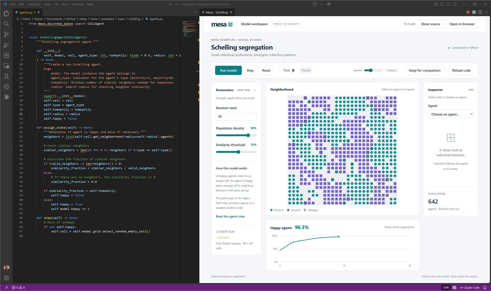
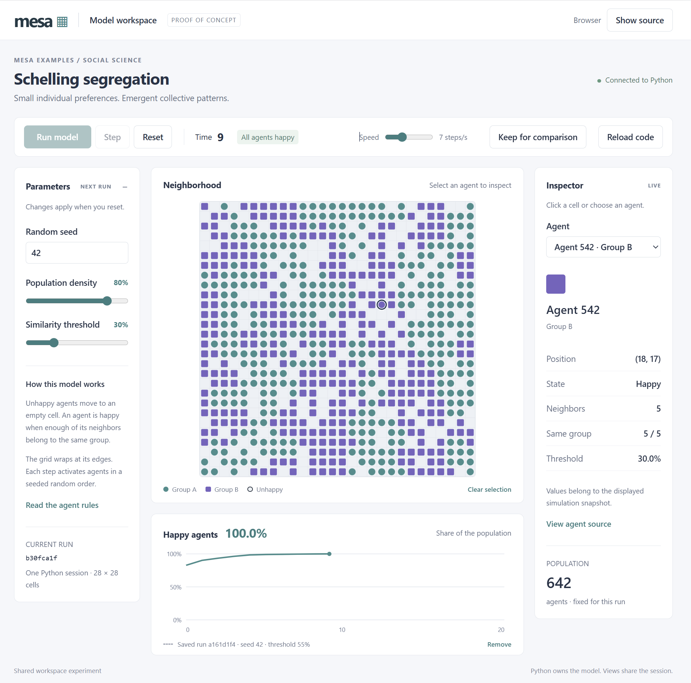

# Shared Mesa workspace: local proof of concept

An isolated pathfinding prototype, not a proposed Mesa API or production application.
It runs the existing Schelling model in this checkout. No Mesa source files or dependency
requirements are changed by the prototype.

## Get the prototype

Python 3.12 or newer is required. Clone the pathfinding branch and install the
checkout into a local environment; the prototype itself needs no JavaScript packages
or additional Python packages beyond Mesa's dependencies.

```sh
git clone --branch viz/shared-workspace-poc https://github.com/EwoutH/mesa.git mesa-workspace-poc
cd mesa-workspace-poc
python -m venv .venv
```

Activate the environment, then install:

```sh
# Linux/macOS
source .venv/bin/activate
python -m pip install -e .
```

```powershell
# Windows PowerShell
.\.venv\Scripts\Activate.ps1
$env:PYTHONUTF8 = '1'
python -m pip install -e .
```

Already working in a Mesa checkout? Fetch this branch instead of cloning again.

## Browser

From the repository root, using a Python environment with Mesa's dependencies:

```powershell
$env:PYTHONUTF8 = '1'
python prototypes/shared-workspace/server.py
```

Open <http://127.0.0.1:8765>. Stop the process with Ctrl+C. Use `--port 0` for an
automatically allocated port; the first output line reports the URL. The same line
contains an ephemeral local session credential for the editor adapter; do not share it.

The same `python prototypes/shared-workspace/server.py` command works on Linux and
macOS after activating the environment.

## VS Code

The extension runs directly from source: no npm install, compilation, or Marketplace
installation is required. From this repository in PowerShell:

```powershell
code --new-window --extensionDevelopmentPath="$PWD/prototypes/shared-workspace/vscode" "$PWD"
```

On Linux/macOS, use:

```sh
code --new-window --extensionDevelopmentPath="$PWD/prototypes/shared-workspace/vscode" "$PWD"
```

In the new Extension Development Host, run **Mesa: Open Shared Workspace** from
the command palette. It opens the real `agents.py` beside the simulation and starts
its own Python session on an available port. The checkout's `.venv` is preferred;
otherwise it uses `python`. Override this with the **Mesa Workspace: Python Path**
setting if needed. This PoC does not yet integrate Python extension environment selection.

Use **Open in browser** in the editor workspace to open a second view of that exact
session. Running, stepping, pausing, or resetting from either host updates both.
Closing the editor visualization ends its Python session; merely hiding it does not.
A separately launched server is a separate session.

## Screenshots

The native editor with Python source beside the shared visualization:



The same components in a browser, with agent inspection and a retained curve:



## Try it

1. Step the model, select an agent, and watch its position and happiness update.
2. Run or pause. Read requests never advance the simulation.
3. Keep a run for comparison, change the seed or threshold, then reset. The retained
   satisfaction curve is drawn as a dashed line. Only this curve is retained, not
   resumable model state. It is stored per browser tab or editor webview.
4. In a browser, **Show source** displays the actual example files read-only. In
   VS Code, the same action opens the real editable file in the native editor.
5. After saving a Python change, **Reload code** reloads the two example modules and
   starts a new run. Runtime exceptions appear in the workspace. This deliberately
   reloads only these modules; it is not general Python hot reload. Edits in VS Code
   change your working copy of Mesa's canonical example, so review those changes.
6. In VS Code, open the browser view and control the same run from both hosts.

## Architecture

```text
Existing Mesa Schelling model
             |
     session.py: one owner, lock, commands, immutable-by-copy snapshots
             |
     server.py: local HTTP JSON API + independent simulation clock
             |
        transport.js
          /       \
   browser fetch   VS Code message bridge → extension → local HTTP
          \       /
       workspace.js + styles.css: the same web component and interactions
```

The editor reads assets directly from the same `web/` directory as the browser.
It does not iframe a separate dashboard. Selection and comparison are presentation
state; model state and scientific observations belong to Python. Monotonic snapshot
revisions prevent an older HTTP response from overwriting a newer command result.

This prototype chooses native JavaScript modules, Canvas, and SVG to avoid a build
step while testing the session/host boundary. It does not settle the eventual choice
of React, deck.gl, chart library, or transport. The 250 ms polling is intentionally
simple; every model step is observed even when a client does not display every frame.

## Checks

```powershell
$env:PYTHONUTF8 = '1'
python -m unittest discover -s prototypes/shared-workspace -p 'test_*.py' -v
node --check prototypes/shared-workspace/vscode/extension.cjs
Get-Content prototypes/shared-workspace/web/workspace.js -Raw | node --input-type=module --check
Get-Content prototypes/shared-workspace/web/transport.js -Raw | node --input-type=module --check
```

Tests cover seeded trajectories, read-only observations, reset, clock ownership,
detached snapshots, revision ordering, reload, and the shared HTTP session boundary.

## Deliberate limits

- One local, shared run per server; no per-user isolation, remote execution, or persistence.
- Fixed Schelling adapter and 28 × 28 grid; no arbitrary-model discovery or renderer plugins.
- A 500-step run limit bounds observation history.
- No debugger integration, source-change detection, notebook adapter, or experiment queue.
- Source editing belongs to VS Code; the browser is an exploration host.
- Loopback binding, request tokens, host/origin checks, and no filesystem API keep the
  local demonstration bounded. This is not an authenticated multi-user service.
- The extension expects its source directory inside this checkout. Packaging and
  distribution are outside this experiment.

The research question is whether a shared simulation client and host-specific source
integration form a useful workspace, without changing how a Mesa model is written.
